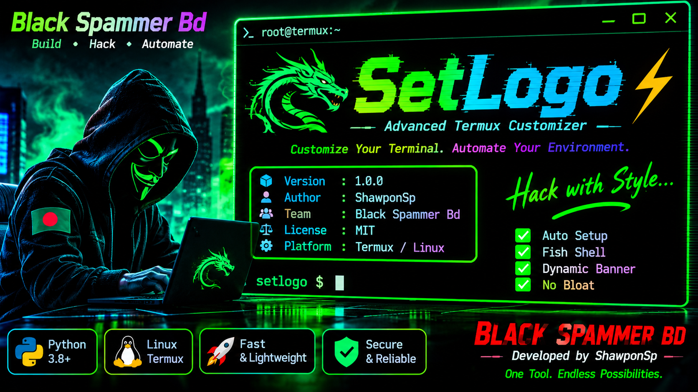

<div align="center">

# ⚡ SetLogo — Advanced Termux Customizer

[](https://www.python.org/)
[](https://opensource.org/licenses/MIT)
[](https://pypi.org/project/setlogo/)
[](https://github.com/Shawpon2)
[](https://github.com/Shawpon2/setlogo/stargazers)

<p align="center">
  
</p>

*A high-performance, lightweight command-line utility engineered to configure Fish shells, automate package deployments, and render dynamic custom hacker banners in Termux environments.*

[**Explore Documentation**](#-table-of-contents) · [**Report Bug**](https://github.com/Shawpon2/setlogo/issues) · [**Request Feature**](https://github.com/Shawpon2/setlogo/issues)

</div>

---

## 📑 Table of Contents

- [About The Project](#-about-the-project)
- [Tech Stack & Creator Information](#-tech-stack--creator-information)
- [Key Features](#-key-features)
- [System Architecture & Workflow](#-system-architecture--workflow)
- [Prerequisites](#-prerequisites)
- [Installation Guide](#-installation-guide)
- [Usage & Command Reference](#-usage--command-reference)
- [Configuration Details](#-configuration-details)
- [Troubleshooting](#-troubleshooting)
- [Contributing Guidelines](#-contributing-guidelines)
- [Support & Contact](#-support--contact)
- [License](#-license)

---

## 🎯 About The Project

**SetLogo** is an elite command-line configuration tool built specifically for developers, cybersecurity enthusiasts, and advanced power users operating within mobile Linux/Termux environments. 

Traditionally, setting up custom shell configurations, installing styling utilities like `figlet` and `lolcat`, and structuring custom fish shell prompts requires multiple manual steps. **SetLogo** automates this entire lifecycle into a single, seamless, production-ready Python CLI package under the flagship of **Black Spammer Bd**.

---

## 🛠️ Tech Stack & Creator Information

| Property | Specification |
| :--- | :--- |
| **Tool Name** | `setlogo` |
| **Creator & SEO Expert** | **ShawponSp** |
| **Team Brand** | **Black Spammer Bd** |
| **Official Support Email** | `blackspammerbd@gmail.com` |
| **GitHub Profile** | [Shawpon2](https://github.com/Shawpon2) |
| **Core Language** | Python 3.x |
| **Shell Framework** | Fish Shell & Bash |
| **Target OS / Environment** | Termux (Android / PRoot Linux) |

---

## ✨ Key Features

* 🚀 **Automated Environment Setup:** Automatically checks, updates, and upgrades core system repositories and package lists.
* 🎨 **Dynamic Slant Banners:** Renders gorgeous ASCII typography paired with randomized, elite cybersecurity and hacking dialogues.
* 🐚 **Advanced Fish Integration:** Replaces legacy bash environments with a high-speed Fish shell setup, complete with custom tailored command prompts.
* 🌈 **Vibrant Aesthetics:** Integrates seamlessly with `figlet`, `toilet`, and Ruby `lolcat` for striking rainbow color gradients.
* 🛡️ **Zero Bloat Architecture:** Lightweight core code ensuring instantaneous execution without dragging down system resources.

---

## ⚙️ System Architecture & Workflow

```text
[ User Input / CLI ] ──> [ setlogo CLI Handler ] ──> [ Package Dependency Checks ]
                                                              │
        ┌─────────────────────────────────────────────────────┘
        ▼
[ Install: fish, ruby, figlet, toilet, lolcat ] ──> [ Generate config.fish ] ──> [ Apply Default Shell: fish ]
